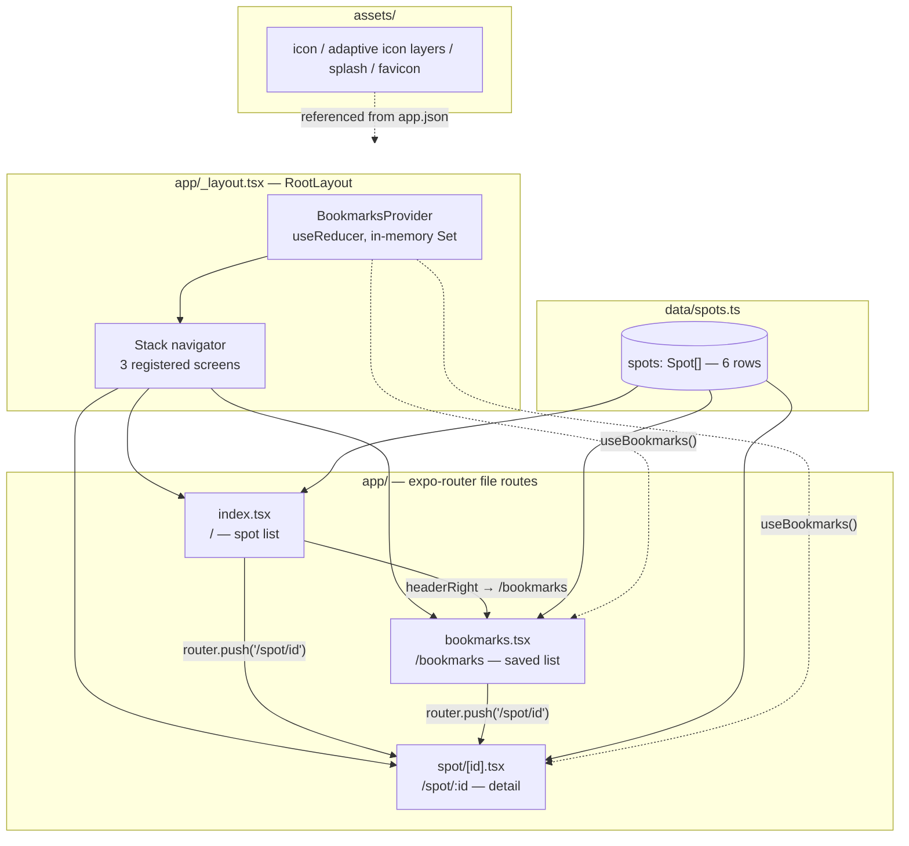
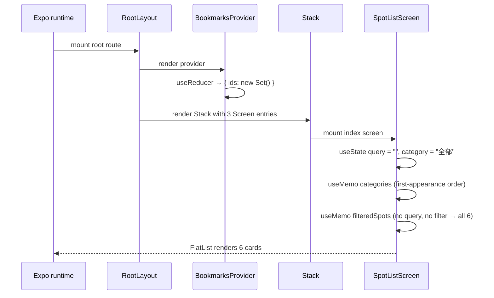
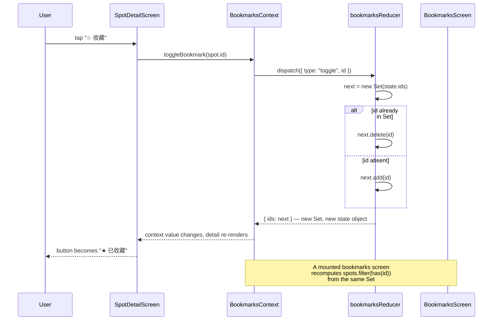
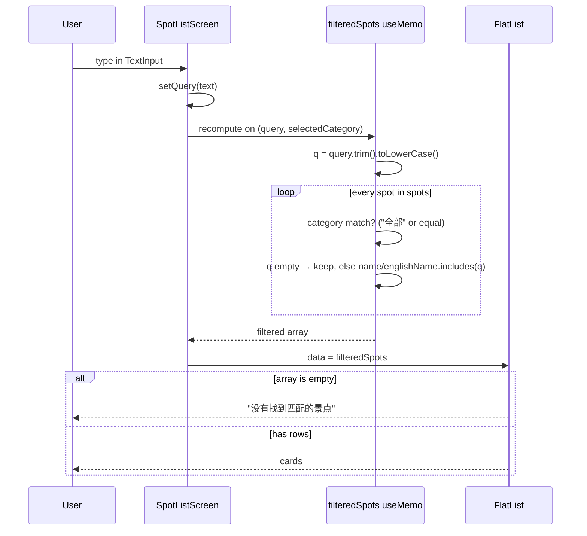
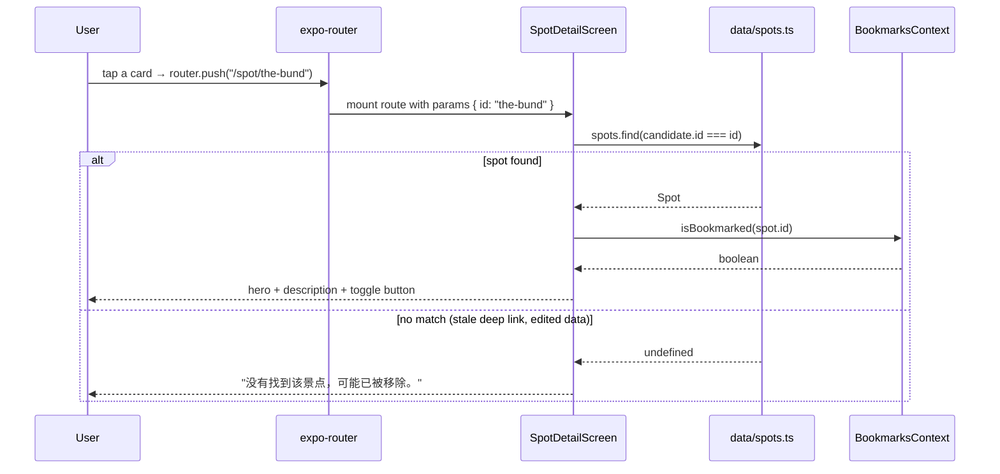
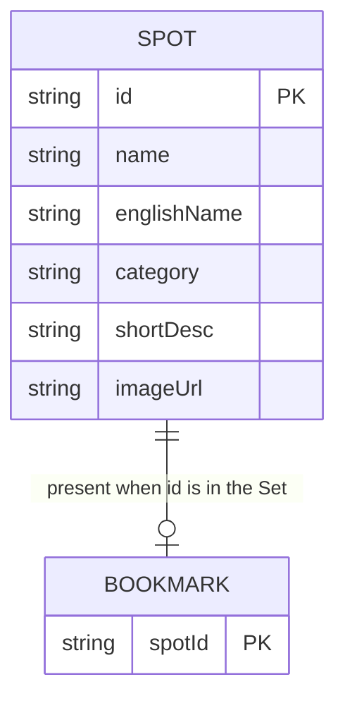
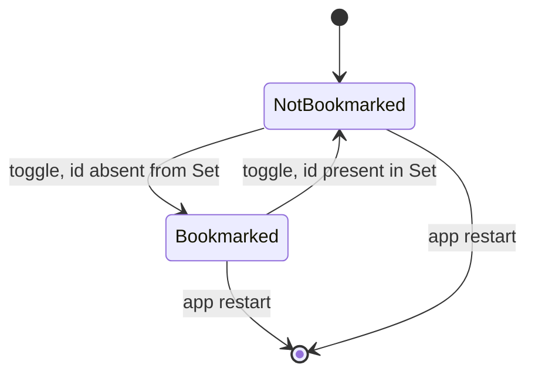

# Projects-app-mvp — Shanghai Spots

[English](README.md) | [简体中文](README.zh-CN.md)

A three-screen Expo + React Native MVP for browsing six Shanghai attractions: a searchable
list, a detail page with a hero image, and a bookmarks screen. Everything is client-side —
the spot data is a static TypeScript module, bookmarks live in a React Context reducer, and
there is no backend, no persistence and no network call beyond loading remote images. The
repository exists to exercise a Claude Code mobile-agent preset (`app-frontend-dev` to
implement, `app-reviewer` to review) against a real Expo project, as stated in `CLAUDE.md`.

---

## Overview

The app answers one narrow question: can an agent-driven workflow build a small but
complete Expo app? The feature set is therefore deliberately minimal.

- **Who it is for**: the author, as a reference project for the mobile-agent preset
  (`CLAUDE.md`, `AGENTS.md`). It is not a product.
- **What it does**: lists six spots (`data/spots.ts`), filters them by free-text search and
  category chips, opens a detail route per spot, and tracks bookmarks in memory.
- **What it does not do**: save bookmarks across restarts, talk to a server, authenticate,
  localise its UI, or ship tests.

The UI language is Chinese; `englishName` is a data field shown next to the Chinese name, not
a localisation layer.

---

## Table of Contents

- [Features](#features)
- [Architecture](#architecture)
- [Key flows](#key-flows)
- [Data model](#data-model)
- [Directory layout](#directory-layout)
- [Getting started](#getting-started)
- [Commands](#commands)
- [Configuration](#configuration)
- [Troubleshooting](#troubleshooting)
- [Design decisions & limitations](#design-decisions--limitations)
- [FAQ](#faq)
- [License](#license)

---

## Features

**Spot list (`app/index.tsx`)**

- `FlatList` of six cards; each card is a 96×96 remote image plus Chinese name, English name
  and a category pill.
- Search field filters on `name` and `englishName`, case-insensitive after `trim()` +
  `toLowerCase()` (`app/index.tsx:37-54`). Descriptions and categories are **not** searched.
- Category chips are derived from the data in first-appearance order, with `全部` prepended
  (`app/index.tsx:27-35`), so a new category appears automatically.
- Tapping the already-selected chip resets the filter to `全部` (`app/index.tsx:56-63`).
- Search and category filters combine with AND.
- Empty result renders `ListEmptyComponent` with the copy “没有找到匹配的景点 / 试试其他关键词，或切换分类。”
- iOS uses the native `clearButtonMode`; Android gets a custom ✕ button because that prop is
  iOS-only (`app/index.tsx:96-106`).
- Keyboard handling: `keyboardDismissMode="on-drag"`, `keyboardShouldPersistTaps="handled"`.
- Header-right `收藏` button pushes `/bookmarks` (`app/index.tsx:69-80`).

**Spot detail (`app/spot/[id].tsx`)**

- Looks the spot up by `id` from `useLocalSearchParams` (`app/spot/[id].tsx:9-11`).
- 240 px hero image, Chinese name, English name, category pill, `shortDesc`.
- One toggle button that reads `☆ 收藏` or `★ 已收藏`; active state turns blue (`#1A73E8`).
- Unknown `id` renders a fallback screen titled `未找到景点` instead of crashing
  (`app/spot/[id].tsx:13-22`).
- Header title is set to the spot name at runtime.

**Bookmarks (`app/bookmarks.tsx`)**

- Renders `spots.filter((spot) => bookmarkedIds.has(spot.id))`, so the order is the order of
  `data/spots.ts`, **not** the order in which the user bookmarked them
  (`app/bookmarks.tsx:11`).
- Empty state explains how to add one: “回到列表页，点开景点详情页的“收藏”按钮即可添加。”
- Tapping a saved card opens the same detail route.

**Shared behaviour**

- `SafeAreaView` from `react-native-safe-area-context` with `edges={['left','right','bottom']}`
  on all three screens; the top inset is handled by the native stack header.
- Every `Pressable` carries `accessibilityRole`, plus `accessibilityLabel` or
  `accessibilityState` (`app/index.tsx:140-165`, `app/bookmarks.tsx:40-55`,
  `app/spot/[id].tsx:39-48`).
- Pressed state is a flat `opacity: 0.85`; cards use `shadow*` + `elevation: 2`.

---

## Architecture



*(source: `app/_layout.tsx`, `app/index.tsx:21`, `app/bookmarks.tsx:9`, `app/spot/[id].tsx:9`)*

| Layer | Path | Responsibility |
|---|---|---|
| Root layout | `app/_layout.tsx` | Wraps the whole tree in `BookmarksProvider`; declares the `Stack` and the three screen titles |
| Route: list | `app/index.tsx` | Search query, selected category, derived category list, filtered data, header button |
| Route: detail | `app/spot/[id].tsx` | Param lookup, hero image, description, bookmark toggle, not-found fallback |
| Route: bookmarks | `app/bookmarks.tsx` | Filters `spots` by the context Set, empty state |
| State | `context/BookmarksContext.tsx` | `useReducer` over `{ ids: ReadonlySet<string> }`, exposes `bookmarkedIds`, `isBookmarked`, `toggleBookmark` |
| Data | `data/spots.ts` | `Spot` interface and the six rows; the only source of truth |
| Config | `app.json` | App name, slug `Projects-app-mvp`, scheme `appmvp`, icons, `expo-router` plugin |
| Assets | `assets/` | App icon, Android adaptive icon layers, splash, favicon |

There is no `src/` directory, no API client, no storage module and no navigation library other
than expo-router's `Stack`. The route table is the file tree; the stack options are the three
`Stack.Screen` entries in `app/_layout.tsx:9-11`.

### Route map

| Route | File | Header title | Header extras |
|---|---|---|---|
| `/` | `app/index.tsx` | `景点收藏本` (from layout) | `收藏` button on the right |
| `/spot/[id]` | `app/spot/[id].tsx` | the spot's `name`, or `未找到景点` | native back button |
| `/bookmarks` | `app/bookmarks.tsx` | `我的收藏` | native back button |

Deep-link scheme: `appmvp://` (`app.json:6`), so `appmvp://spot/the-bund` opens that detail
route when the app is running.

---

## Key flows

### 1. Cold start — provider, then navigator, then list



Because the provider sits above the `Stack`, bookmark state survives every push/pop within a
session. It dies with the JS context — app restart, reload, or provider unmount.

### 2. Bookmark toggle



The reducer never mutates the existing `Set`; it clones first (`context/BookmarksContext.tsx:25-33`).
Returning a new object is what makes the memoised context value change
(`context/BookmarksContext.tsx:63-66`). `toggleBookmark` is a stable `useCallback([])`, so
consumers do not re-render just because it was recreated.

### 3. Search and category filtering



Chip presses take a different path but feed the same memo: `handleCategoryPress` sets
`selectedCategory`, and a tap on the active chip (that is not `全部`) resets it
(`app/index.tsx:56-63`). Both filters run per keystroke over six in-memory rows — no
debounce, no async, no index.

### 4. Opening a detail route



---

## Data model



*(source: `data/spots.ts:1-8`, `context/BookmarksContext.tsx:14-16`)*

`Bookmark` is not an entity with a table or a file — it is membership in a
`ReadonlySet<string>`. The diagram shows it as a row so the key relationship is explicit.

### `Spot` fields

| Field | Type | Used by | Notes |
|---|---|---|---|
| `id` | `string` | detail lookup, `keyExtractor`, bookmarks | Slugs such as `the-bund`, `yu-garden` |
| `name` | `string` | list card, detail title, search | Chinese name |
| `englishName` | `string` | list card, detail, search | Display-only; UI stays Chinese |
| `category` | `string` | chips, card pill, filter | Free-form; chips are derived from the data |
| `shortDesc` | `string` | detail body | 1–2 sentences, Chinese |
| `imageUrl` | `string` | card and hero `<Image>` | Wikimedia Commons `Special:FilePath` URL with `?width=800` |

### The six rows

| `id` | `name` | `englishName` | `category` |
|---|---|---|---|
| `the-bund` | 外滩 | The Bund | 历史建筑 |
| `yu-garden` | 豫园 | Yu Garden | 古典园林 |
| `oriental-pearl-tower` | 东方明珠塔 | Oriental Pearl Tower | 现代地标 |
| `shanghai-museum` | 上海博物馆 | Shanghai Museum | 博物馆 |
| `tianzifang` | 田子坊 | Tianzifang | 文创街区 |
| `jingan-temple` | 静安寺 | Jing'an Temple | 宗教场所 |

### Bookmark state

| Field | Type | Notes |
|---|---|---|
| `ids` | `ReadonlySet<string>` | Spot IDs only; no timestamps, no order, no metadata |
| action `toggle` | `{ type: 'toggle'; id: string }` | The only action the reducer handles |
| `bookmarkedIds` | `ReadonlySet<string>` (exposed) | Consumed by the bookmarks screen |
| `isBookmarked(id)` | `() => boolean` | Consumed by the detail screen |
| `toggleBookmark(id)` | `() => void` | Dispatches `toggle` |



No intermediate or error state exists: the toggle is synchronous and cannot fail. A restart
returns every spot to `NotBookmarked` because the initial state is a fresh empty `Set`
(`context/BookmarksContext.tsx:50-52`).

---

## Directory layout

```text
Projects-app-mvp/
├─ app/                        # expo-router file routes (URL mirrors file path)
│  ├─ _layout.tsx              # RootLayout: provider + Stack + 3 screen titles
│  ├─ index.tsx                # "/" spot list, search field, category chips
│  ├─ bookmarks.tsx            # "/bookmarks" saved spots + empty state
│  └─ spot/
│     └─ [id].tsx              # "/spot/:id" detail, hero image, toggle button
├─ context/
│  └─ BookmarksContext.tsx     # provider, reducer, useBookmarks hook
├─ data/
│  └─ spots.ts                 # Spot interface + 6 static rows
├─ assets/                     # icon, Android adaptive layers, splash, favicon
├─ .claude/settings.json       # enables the expo plugin for Claude Code
├─ AGENTS.md                   # "read the SDK 57 docs before writing code"
├─ CLAUDE.md                   # project rules: app-frontend-dev / app-reviewer
├─ app.json                    # Expo config
├─ eslint.config.js            # eslint-config-expo flat config
├─ package.json                # dependencies and the 5 expo scripts
├─ tsconfig.json               # extends expo/tsconfig.base, strict: true
├─ LICENSE                     # MIT
└─ README.md / README.zh-CN.md
```

Not present, and therefore not documented: `ios/`, `android/`, `eas.json`, `src/`,
`__tests__/`, any CI workflow, any `.env` file.

---

## Getting started

### Prerequisites

| Requirement | Detail |
|---|---|
| Node.js | `^20.19.4 \|\| ^22.13.0 \|\| ^24.3.0 \|\| >= 25.0.0` — the `engines` range declared by `react-native@0.86.0` in `package-lock.json` |
| npm | Ships with Node; `package-lock.json` (lockfile v3) is committed |
| Expo Go (SDK 57) or a simulator/emulator | Recommended path; the project has no `expo-dev-client` and no native folders |
| A modern browser | Only for the web target. `react-dom`, `react-native-web` and `@expo/metro-runtime` are already declared, so `npm run web` needs no extra install |
| Network access | Card and hero images are remote Wikimedia Commons URLs |

### Install and run

```bash
git clone https://github.com/Ethan-upgrade/Projects-app-mvp.git
cd Projects-app-mvp
npm install
npx expo start
```

Then either scan the QR code with Expo Go (SDK 57) or press `a` for an Android emulator / `i`
for an iOS simulator. Script shortcuts:

```bash
npm run android    # expo start --android
npm run ios        # expo start --ios
npm run web        # expo start --web — opens the app in a browser
```

The web target works out of the box: `react-dom`, `react-native-web` and `@expo/metro-runtime`
are declared in `package.json`, so `npm run web` starts the dev server without prompting to
install anything. `npx expo export --platform web` builds the same app to `dist/` (git-ignored)
and is the quickest way to confirm the web bundle still compiles.

There is no build step for native code: the repo commits no `ios/` or `android/` directories
(they are git-ignored) and relies on Expo's managed workflow / continuous native generation.
If you need a standalone binary, run `npx expo run:android` or `npx expo run:ios` locally, or
set up EAS — neither is configured in this repository.

### Verify a change

```bash
npx tsc --noEmit                  # type-check (strict)
npx eslint .                      # same config as `npm run lint`
npx expo export --platform web    # web target still bundles
```

These are the project's stated verification gate (`CLAUDE.md`) plus a web build. There is no
test script and no test runner installed.

---

## Commands

| Command | Does |
|---|---|
| `npm start` | `expo start` — dev server + QR code |
| `npm run android` | `expo start --android` — open on a connected Android emulator/device |
| `npm run ios` | `expo start --ios` — open on the iOS simulator (macOS) |
| `npm run web` | `expo start --web` — open in a browser (web deps are installed) |
| `npm run lint` | `expo lint` (flat config in `eslint.config.js`) |
| `npx tsc --noEmit` | TypeScript check, strict mode (`tsconfig.json`) |
| `npx expo export --platform web` | Production web bundle into `dist/`; proves the web target builds |
| `npx expo start -c` | Same as `npm start` with a cleared Metro cache |

---

## Configuration

There are no environment variables and no runtime config file. The only configuration is
`app.json`.

| Key | Value | Meaning |
|---|---|---|
| `expo.name` | `Projects-app-mvp` | Display name |
| `expo.slug` | `Projects-app-mvp` | Expo project slug (mixed case, as committed) |
| `expo.version` | `1.0.0` | App version |
| `expo.scheme` | `appmvp` | Deep-link scheme (`appmvp://spot/the-bund`) |
| `expo.orientation` | `portrait` | Locked to portrait |
| `expo.userInterfaceStyle` | `light` | Light UI only; no dark-mode palette |
| `expo.ios.supportsTablet` | `true` | Runs on iPad without a tablet-specific layout |
| `expo.android.adaptiveIcon` | background `#E6F4FE` + 3 images | Android launcher icon layers |
| `expo.android.predictiveBackGestureEnabled` | `false` | Android predictive back is off |
| `expo.web.favicon` | `./assets/favicon.png` | Only web-specific setting |
| `expo.plugins` | `["expo-router"]` | The router plugin; no other config plugins |

Expo SDK is pinned by `package.json` to `~57.0.6`; React Native to `0.86.0`, React to
`19.2.3`. `npx expo install --check` reports drift from the SDK 57 matrix if you add a
dependency.

---

## Troubleshooting

| Symptom | Cause | Fix |
|---|---|---|
| “Project is incompatible with this version of Expo Go” | Expo Go on the device has a different SDK | Install an Expo Go build that supports SDK 57, or use a simulator |
| Cards and hero images are blank | The six images are remote Wikimedia URLs; no bundled fallback | Check connectivity; the layout still renders without images |
| Bookmarks disappear after reloading the app | In-memory only — no AsyncStorage is wired up | Expected; see [Design decisions](#design-decisions--limitations) |
| `Error: useBookmarks must be used within a BookmarksProvider` | A screen using `useBookmarks` was rendered outside `app/_layout.tsx` | Keep the provider above every route; check a custom entry point |
| Tapping a card lands on “未找到景点” | `id` does not match any row in `data/spots.ts` (edited data or stale link) | Align the link with a real `id` |
| Type check fails after editing data | A `Spot` field was removed or renamed | `Spot` requires all six fields (`data/spots.ts:1-8`) |
| Metro serves stale code | Cache | `npx expo start -c` |

---

## Design decisions & limitations

- **In-memory bookmarks.** The reducer holds a `Set<string>` in React state; nothing is
  written to `AsyncStorage`, SecureStore or a server. Closing the app clears the list. This is
  called out in the source (`context/BookmarksContext.tsx:10-12`) so it is not mistaken for a
  bug. Adding persistence means hydrating the initial state and writing on every change — one
  `useEffect` — but it changes the “no side effects” property the MVP is demonstrating.
- **Static data, no data layer.** `data/spots.ts` is imported directly by three screens. There
  is no fetch hook, no loading state, no error state and no caching. Editing the file is the
  only way to change content.
- **No backend, no auth.** Nothing leaves the device except image requests to
  `commons.wikimedia.org`. There is no API surface to document.
- **Order is data order, not bookmark order.** The bookmarks screen filters `spots`, so saved
  items always appear in the fixed order of the source array. A `Set` also carries no
  timestamps, so “recently saved” is not expressible without changing the state shape.
- **Search is substring-only.** No fuzzy matching, no pinyin, no description/category text.
  Category is a separate, explicit filter, which is why the two can be combined predictably.
- **One global stack, no tabs.** Three screens, native header, default back gesture. There is
  no tab bar, drawer, modal or nested navigator.
- **UI copy is Chinese and hardcoded.** No i18n library, no locale switch. `englishName` is
  data, not translation.
- **Three targets, one codebase.** The same screens run on iOS, Android and the web through
  `react-native-web`; the web target has no router-specific overrides and `app.json` carries
  only a favicon for it.
- **No tests, no CI.** No test runner, no `test` script, no workflow file. Verification is
  `tsc --noEmit` plus `eslint`. Filtering and the reducer are pure and easy to test if that
  changes.
- **Light theme only.** `userInterfaceStyle: "light"` and hardcoded hex colours
  (`#F5F5F7` background, `#1A73E8` accent, `#EAF1FE` chip fill) — there is no theme object.
- **Images depend on a third party.** Wikimedia Commons URLs use `Special:FilePath` plus
  `?width=800` (`data/spots.ts:10-12`); availability, redirect behaviour and licensing are
  outside this repository's control.

---

## FAQ

**Where do bookmarks go when I close the app?** Nowhere — they are a `Set` in React state and
are recreated empty on the next launch.

**Does search look at the description or category?** No. It checks `name` and `englishName`
only, case-insensitively, after trimming. Use the category chips for category filtering.

**Why does the bookmarks list not match the order I saved things?** The screen filters
`data/spots.ts`, so order follows the data file. Bookmarks are a set, with no ordering.

**How do I add a spot?** Append an object with all six `Spot` fields to `spots`. The list, the
detail route and the category chips pick it up with no other change; a new `category` value
adds a chip automatically.

**How do I add a screen?** Create a file under `app/` — expo-router turns it into a route. Add
a `<Stack.Screen name="…" options={{ title: '…' }} />` entry in `app/_layout.tsx` if you want a
custom title; otherwise the header falls back to the route name.

**Can I deep-link to a spot?** Yes: `appmvp://spot/the-bund` with a valid `id`. An invalid one
renders the not-found screen rather than throwing.

**Is there a dark theme?** Not implemented. `app.json` pins `userInterfaceStyle` to `light` and
every colour is a literal in a `StyleSheet`.

**Why is `README_EN.md` gone?** This repository now keeps `README.md` (English) and
`README.zh-CN.md` (Chinese), following the documentation spec the repo is maintained under.

**What are `CLAUDE.md` and `AGENTS.md` for?** They document how the project should be worked
on: use the `app-frontend-dev` / `app-reviewer` mobile agents, verify with `tsc` and `eslint`,
and never run `expo start` in the foreground during automated work. They are instructions for
tooling, not part of the app.

---

## License

MIT. The bundled `LICENSE` file is the stock Expo template text, so its copyright line reads
“Copyright (c) 2015-present 650 Industries, Inc. (aka Expo)” rather than the repository owner.
Replace that line if you redistribute the project under your own name.
