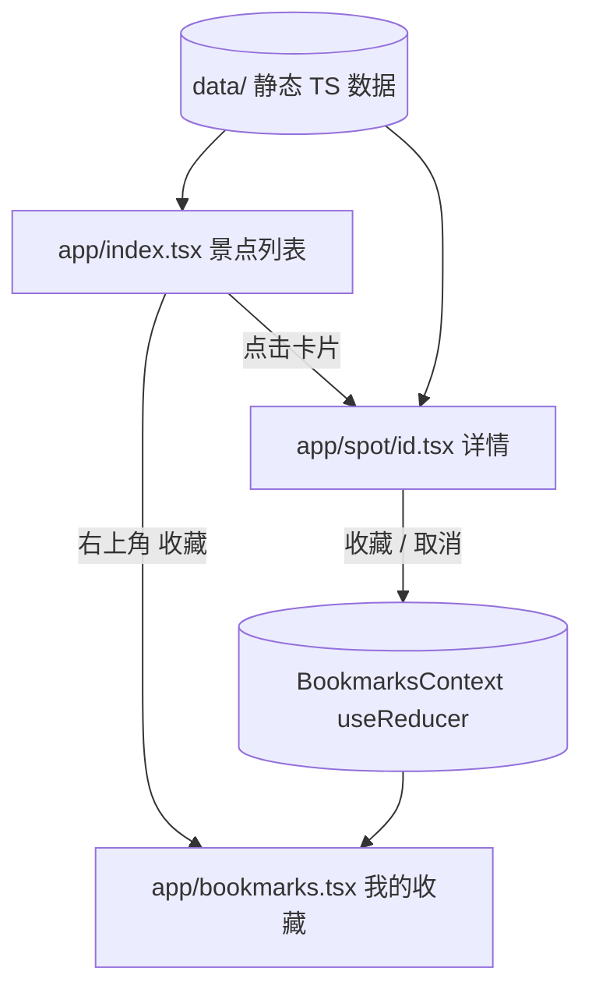

# 景点收藏本（Projects-app-mvp）

用 **Expo + React Native** 写的纯客户端移动端 MVP：浏览上海几个代表性景点、查看详情、把喜欢的景点加入收藏。主要目的是验证一套 **Claude Code 移动端 agent 预设**（`app-frontend-dev` 负责实现、`app-reviewer` 负责只读审查）在真实 Expo 项目上的开发与审查流程。功能刻意保持很小：**无后端，数据是静态 TypeScript 模块**。

## 主要功能
- **景点列表**（`app/index.tsx`）：卡片展示 6 个上海景点（外滩/豫园/东方明珠/上海博物馆/田子坊/静安寺），支持**中英文名搜索 + 分类筛选**（可叠加），无结果显示空状态。
- **景点详情**（`app/spot/[id].tsx`）：大图、简介、收藏/取消收藏切换；ID 不存在显示兜底提示。
- **我的收藏**（`app/bookmarks.tsx`）：列出已收藏景点，空列表显示引导。
> 收藏状态仅存内存，重启 App 清空（MVP 有意省略 AsyncStorage，非 bug）。

## 技术栈
| 项 | 版本/说明 |
|----|-----------|
| Expo SDK | 57 |
| React Native | 0.86 |
| React | 19.2 |
| 路由 | expo-router（`app/` 目录文件路由，Stack 导航） |
| 语言 | TypeScript（strict） |
| 状态管理 | React Context + `useReducer`（`context/BookmarksContext.tsx`） |

## 架构与流程


## 项目结构
```
Projects-app-mvp/
├─ app/            # expo-router 页面（index / spot/[id] / bookmarks）
├─ context/        # BookmarksContext（状态）
├─ data/           # 静态景点数据
├─ assets/
├─ app.json / package.json / tsconfig.json
└─ README.md / README_EN.md
```

## 快速开始
```
npm install
npx expo start      # 用 Expo Go 或模拟器打开
```

## 许可证
见仓库 `LICENSE`。