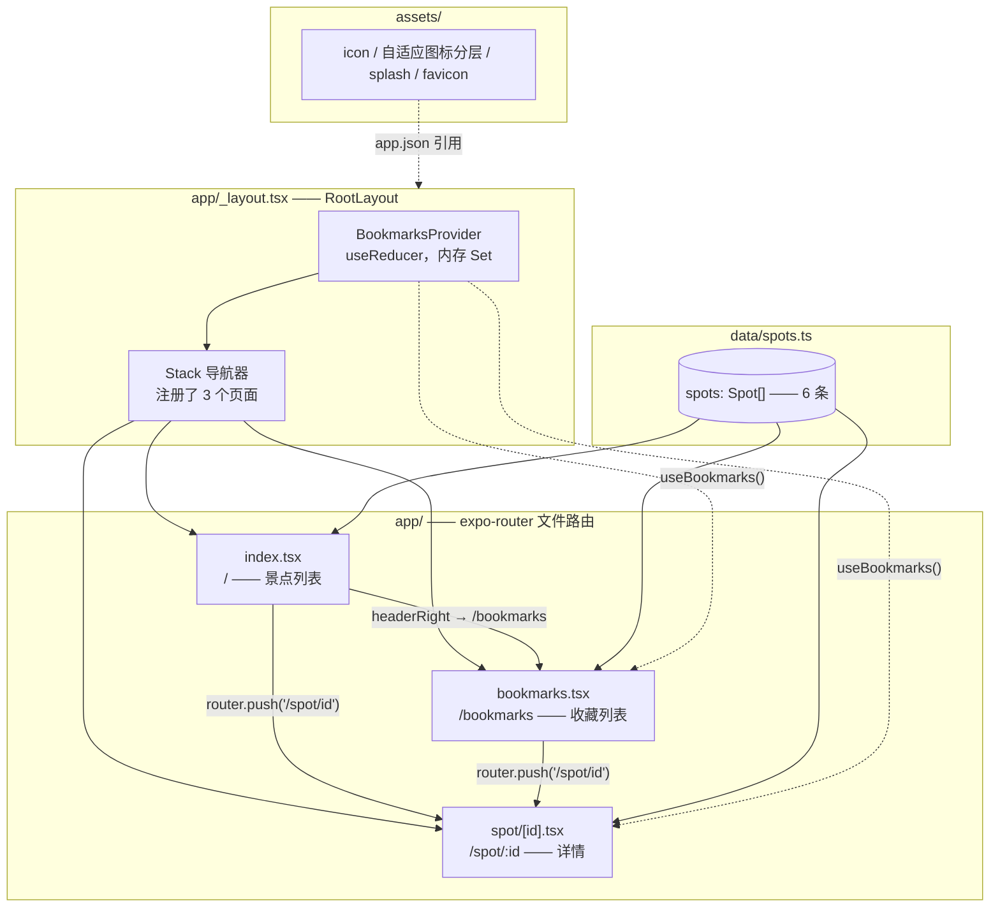
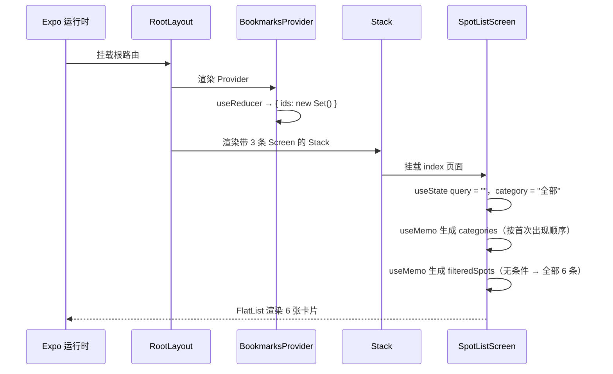
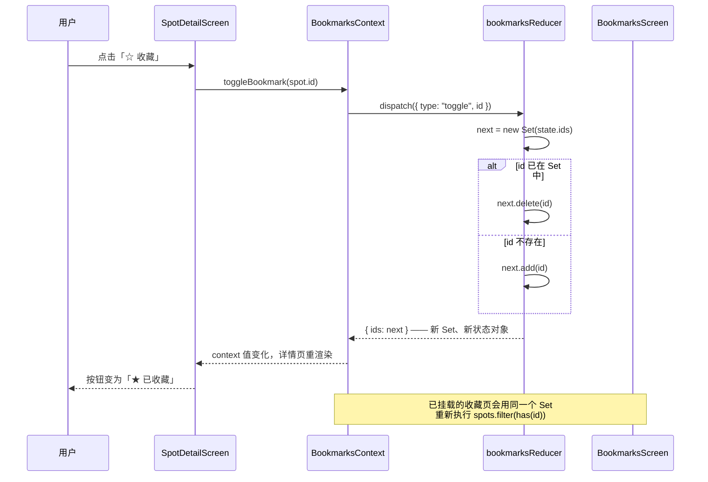
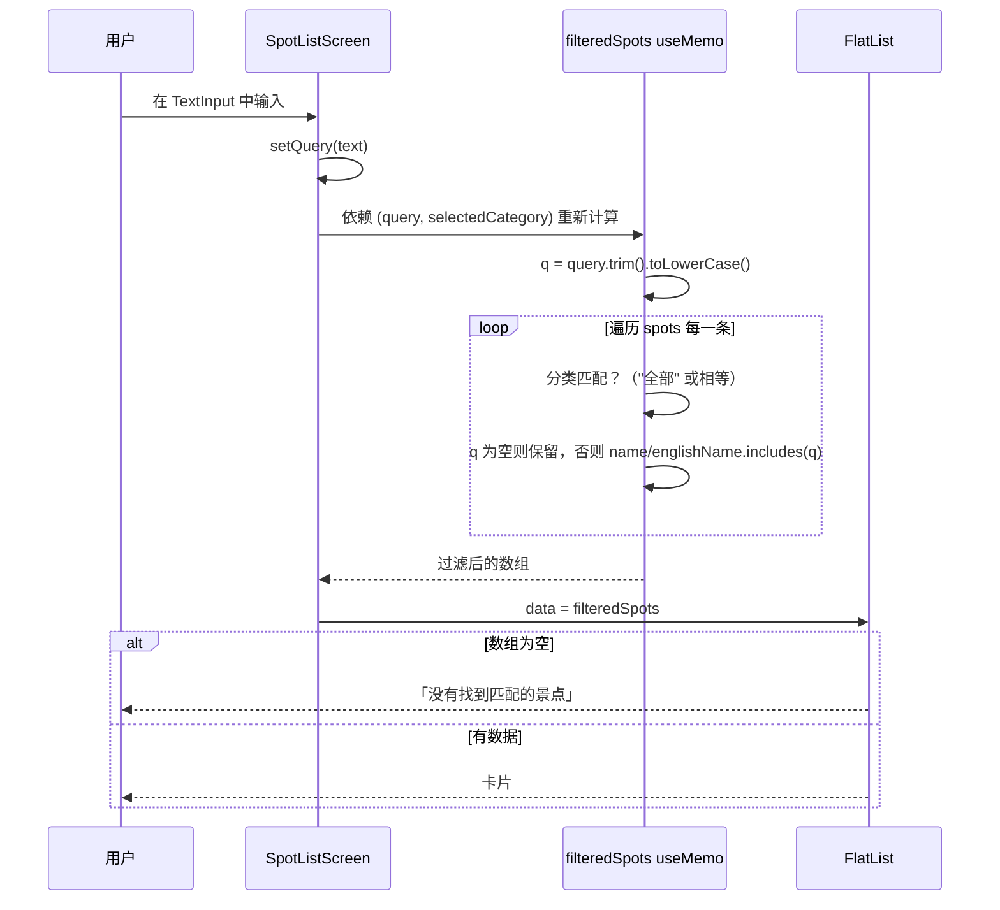
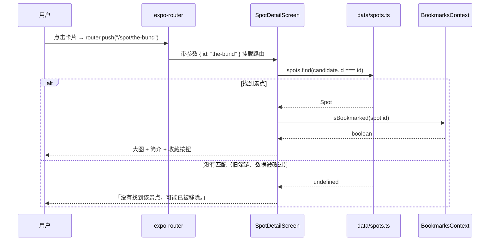
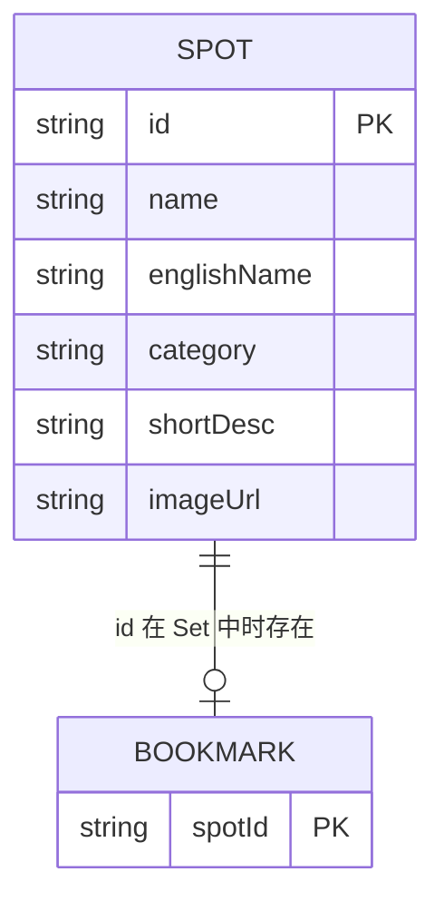
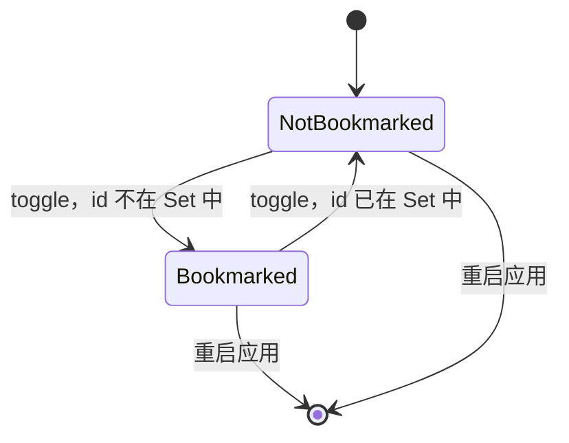

# Projects-app-mvp — 上海景点收藏本

[English](README.md) | [简体中文](README.zh-CN.md)

一个只有三个页面的 Expo + React Native 移动端 MVP：浏览六个上海景点、搜索与分类筛选、查看详情、
收藏喜欢的景点。全部逻辑都在客户端——景点数据是一个静态 TypeScript 模块，收藏状态放在 React
Context 的 reducer 里，没有后端、不做持久化，除了加载远程图片之外没有任何网络请求。这个仓库的用途
是拿一个真实的 Expo 项目来验证 Claude Code 的移动端 agent 预设（`app-frontend-dev` 负责实现、
`app-reviewer` 负责只读审查），这一点写在 `CLAUDE.md` 里。

---

## 概览

这个 App 只回答一个问题：agent 驱动的工作流能不能做出一个小而完整的 Expo 应用？所以功能被刻意压到最小。

- **给谁用**：作者本人，作为移动端 agent 预设的参考项目（见 `CLAUDE.md`、`AGENTS.md`）。它不是产品。
- **做了什么**：列出六个景点（`data/spots.ts`），支持关键词搜索 + 分类 chip 筛选，每个景点有独立详情路由，收藏状态保存在内存里。
- **没做什么**：不跨重启保存收藏、不连服务端、没有鉴权、没有国际化、没有测试。

界面文案是中文；`englishName` 只是一个随中文名一起展示的数据字段，不是国际化层。

---

## 目录

- [功能](#功能)
- [架构](#架构)
- [关键流程](#关键流程)
- [数据模型](#数据模型)
- [目录结构](#目录结构)
- [快速开始](#快速开始)
- [命令](#命令)
- [配置](#配置)
- [排错](#排错)
- [设计取舍与已知限制](#设计取舍与已知限制)
- [FAQ](#faq)
- [许可](#许可)

---

## 功能

**景点列表（`app/index.tsx`）**

- `FlatList` 渲染六张卡片，每张由 96×96 的远程图片、中文名、英文名和分类 pill 组成。
- 搜索框按 `name` 和 `englishName` 过滤，先 `trim()` 再 `toLowerCase()`，大小写不敏感
  （`app/index.tsx:37-54`）。简介和分类**不**参与搜索。
- 分类 chip 从数据中按首次出现顺序推导，并在最前面补一个 `全部`（`app/index.tsx:27-35`），
  因此新数据里出现新分类时会自动多出一个 chip。
- 再点一次已选中的 chip（`全部` 除外）会把筛选重置回 `全部`（`app/index.tsx:56-63`）。
- 关键词与分类两个条件按 AND 叠加。
- 结果为空时由 `ListEmptyComponent` 渲染「没有找到匹配的景点 / 试试其他关键词，或切换分类。」
- iOS 用原生的 `clearButtonMode`；Android 因为该属性只在 iOS 生效，单独渲染了一个 ✕ 按钮
  （`app/index.tsx:96-106`）。
- 键盘处理：`keyboardDismissMode="on-drag"`、`keyboardShouldPersistTaps="handled"`。
- 导航栏右侧的「收藏」按钮 push 到 `/bookmarks`（`app/index.tsx:69-80`）。

**景点详情（`app/spot/[id].tsx`）**

- 用 `useLocalSearchParams` 取出 `id` 后在 `spots` 中查找（`app/spot/[id].tsx:9-11`）。
- 240px 大图、中文名、英文名、分类 pill、`shortDesc`。
- 一个收藏按钮，文案在 `☆ 收藏` 与 `★ 已收藏` 之间切换，激活态为蓝色（`#1A73E8`）。
- `id` 不存在时渲染标题为 `未找到景点` 的兜底页，而不是崩溃（`app/spot/[id].tsx:13-22`）。
- 导航栏标题在运行时被设置为景点名。

**我的收藏（`app/bookmarks.tsx`）**

- 渲染 `spots.filter((spot) => bookmarkedIds.has(spot.id))`，因此顺序是 `data/spots.ts` 的顺序，
  **不是**用户收藏的先后顺序（`app/bookmarks.tsx:11`）。
- 空状态说明如何添加：「回到列表页，点开景点详情页的“收藏”按钮即可添加。」
- 点击已收藏的卡片同样进入详情路由。

**共性行为**

- 三个页面都用 `react-native-safe-area-context` 的 `SafeAreaView`，`edges={['left','right','bottom']}`；
  顶部安全区由原生 Stack 头部负责。
- 每个 `Pressable` 都带 `accessibilityRole`，以及 `accessibilityLabel` 或 `accessibilityState`
  （`app/index.tsx:140-165`、`app/bookmarks.tsx:40-55`、`app/spot/[id].tsx:39-48`）。
- 按压反馈统一是 `opacity: 0.85`；卡片阴影用 `shadow*` 加 `elevation: 2`。

---

## 架构



*（源码：`app/_layout.tsx`、`app/index.tsx:21`、`app/bookmarks.tsx:9`、`app/spot/[id].tsx:9`）*

| 层 | 路径 | 职责 |
|---|---|---|
| 根布局 | `app/_layout.tsx` | 用 `BookmarksProvider` 包住整棵树；声明 `Stack` 与三个页面的标题 |
| 路由：列表 | `app/index.tsx` | 搜索词、选中分类、派生分类列表、过滤后的数据、导航栏按钮 |
| 路由：详情 | `app/spot/[id].tsx` | 参数查找、大图、简介、收藏切换、未找到兜底 |
| 路由：收藏 | `app/bookmarks.tsx` | 按 Context 里的 Set 过滤 `spots`，空状态 |
| 状态 | `context/BookmarksContext.tsx` | 对 `{ ids: ReadonlySet<string> }` 做 `useReducer`，暴露 `bookmarkedIds`、`isBookmarked`、`toggleBookmark` |
| 数据 | `data/spots.ts` | `Spot` 接口与六条记录，唯一数据来源 |
| 配置 | `app.json` | 应用名、slug `Projects-app-mvp`、scheme `appmvp`、图标、`expo-router` 插件 |
| 资源 | `assets/` | 应用图标、Android 自适应图标分层、启动图、favicon |

没有 `src/` 目录，没有 API 客户端，没有存储模块，除了 expo-router 的 `Stack` 之外也没有其他导航库。
路由表就是文件树；Stack 的配置就是 `app/_layout.tsx:9-11` 里的三条 `Stack.Screen`。

### 路由表

| 路由 | 文件 | 导航栏标题 | 导航栏其他元素 |
|---|---|---|---|
| `/` | `app/index.tsx` | `景点收藏本`（来自布局） | 右侧「收藏」按钮 |
| `/spot/[id]` | `app/spot/[id].tsx` | 景点 `name`，或 `未找到景点` | 原生返回按钮 |
| `/bookmarks` | `app/bookmarks.tsx` | `我的收藏` | 原生返回按钮 |

深链 scheme 为 `appmvp://`（`app.json:6`），应用运行时 `appmvp://spot/the-bund` 可直接打开对应详情页。

---

## 关键流程

### 1. 冷启动——先 Provider，再导航器，再列表



Provider 位于 `Stack` 之上，所以收藏状态能跨本次会话内的所有 push/pop 存活；它随 JS 上下文一起销毁
——重启应用、reload、或 Provider 卸载都会清空。

### 2. 收藏切换



Reducer 从不原地修改旧的 `Set`，而是先克隆（`context/BookmarksContext.tsx:25-33`）。返回新对象正是
memo 化的 context 值能够变化的原因（`context/BookmarksContext.tsx:63-66`）。`toggleBookmark` 是依赖为
`[]` 的固定 `useCallback`，所以消费方不会仅仅因为它被重建而重渲染。

### 3. 搜索与分类筛选



点击 chip 走的是另一条路径但汇入同一个 memo：`handleCategoryPress` 设置 `selectedCategory`，再点一次
当前激活的 chip（且不是 `全部`）则重置（`app/index.tsx:56-63`）。两个条件在每次按键时对六条内存数据
重算一遍——没有防抖、没有异步、没有索引。

### 4. 打开详情路由



---

## 数据模型



*（源码：`data/spots.ts:1-8`、`context/BookmarksContext.tsx:14-16`）*

`Bookmark` 并不是带表或文件的实体——它只是 `ReadonlySet<string>` 里的成员关系。图里把它画成一行，是为了
把主键关系讲清楚。

### `Spot` 字段

| 字段 | 类型 | 使用方 | 说明 |
|---|---|---|---|
| `id` | `string` | 详情查找、`keyExtractor`、收藏 | 形如 `the-bund`、`yu-garden` 的 slug |
| `name` | `string` | 列表卡片、详情标题、搜索 | 中文名 |
| `englishName` | `string` | 列表卡片、详情、搜索 | 仅用于展示；界面仍是中文 |
| `category` | `string` | chip、卡片 pill、筛选 | 自由文本；chip 由数据推导 |
| `shortDesc` | `string` | 详情正文 | 一到两句中文简介 |
| `imageUrl` | `string` | 卡片与头图 `<Image>` | Wikimedia Commons 的 `Special:FilePath` 地址，带 `?width=800` |

### 六条数据

| `id` | `name` | `englishName` | `category` |
|---|---|---|---|
| `the-bund` | 外滩 | The Bund | 历史建筑 |
| `yu-garden` | 豫园 | Yu Garden | 古典园林 |
| `oriental-pearl-tower` | 东方明珠塔 | Oriental Pearl Tower | 现代地标 |
| `shanghai-museum` | 上海博物馆 | Shanghai Museum | 博物馆 |
| `tianzifang` | 田子坊 | Tianzifang | 文创街区 |
| `jingan-temple` | 静安寺 | Jing'an Temple | 宗教场所 |

### 收藏状态

| 字段 | 类型 | 说明 |
|---|---|---|
| `ids` | `ReadonlySet<string>` | 只存景点 ID；没有时间戳、没有顺序、没有额外元数据 |
| action `toggle` | `{ type: 'toggle'; id: string }` | Reducer 只处理这一种 action |
| `bookmarkedIds` | `ReadonlySet<string>`（对外暴露） | 收藏页消费 |
| `isBookmarked(id)` | `() => boolean` | 详情页消费 |
| `toggleBookmark(id)` | `() => void` | 派发 `toggle` |



不存在中间态或错误态：切换是同步的，也不会失败。重启后所有景点都回到 `NotBookmarked`，因为初始状态就是
一个全新的空 `Set`（`context/BookmarksContext.tsx:50-52`）。

---

## 目录结构

```text
Projects-app-mvp/
├─ app/                        # expo-router 文件路由（URL 即文件路径）
│  ├─ _layout.tsx              # RootLayout：Provider + Stack + 三个页面标题
│  ├─ index.tsx                # "/" 景点列表、搜索框、分类 chip
│  ├─ bookmarks.tsx            # "/bookmarks" 收藏列表 + 空状态
│  └─ spot/
│     └─ [id].tsx              # "/spot/:id" 详情、头图、收藏按钮
├─ context/
│  └─ BookmarksContext.tsx     # Provider、reducer、useBookmarks
├─ data/
│  └─ spots.ts                 # Spot 接口 + 6 条静态数据
├─ assets/                     # 图标、Android 自适应分层、启动图、favicon
├─ .claude/settings.json       # 为 Claude Code 启用 expo 插件
├─ AGENTS.md                   # 「写代码前先读 SDK 57 文档」
├─ CLAUDE.md                   # 项目规则：app-frontend-dev / app-reviewer
├─ app.json                    # Expo 配置
├─ eslint.config.js            # eslint-config-expo 的 flat 配置
├─ package.json                # 依赖与 5 条 expo 脚本
├─ tsconfig.json               # extends expo/tsconfig.base，strict: true
├─ LICENSE                     # MIT
└─ README.md / README.zh-CN.md
```

以下内容不存在，因此也不做文档：`ios/`、`android/`、`eas.json`、`src/`、`__tests__/`、任何 CI 工作流、
任何 `.env` 文件。

---

## 快速开始

### 前置条件

| 要求 | 说明 |
|---|---|
| Node.js | `^20.19.4 \|\| ^22.13.0 \|\| ^24.3.0 \|\| >= 25.0.0`——`react-native@0.86.0` 在 `package-lock.json` 里声明的 `engines` 范围 |
| npm | 随 Node 提供；仓库提交了 `package-lock.json`（lockfile v3） |
| Expo Go（SDK 57）或模拟器/仿真器 | 推荐路径；项目没有 `expo-dev-client`，也没有原生目录 |
| 现代浏览器 | 仅 Web 目标需要。`react-dom`、`react-native-web`、`@expo/metro-runtime` 已在依赖里，`npm run web` 不需要额外安装 |
| 网络 | 卡片与头图都是 Wikimedia Commons 的远程地址 |

### 安装与运行

```bash
git clone https://github.com/Ethan-upgrade/Projects-app-mvp.git
cd Projects-app-mvp
npm install
npx expo start
```

然后用 Expo Go（SDK 57）扫码，或按 `a` 打开 Android 仿真器、按 `i` 打开 iOS 模拟器。脚本快捷方式：

```bash
npm run android    # expo start --android
npm run ios        # expo start --ios
npm run web        # expo start --web —— 在浏览器里打开
```

Web 目标开箱即用：`react-dom`、`react-native-web`、`@expo/metro-runtime` 都已写进 `package.json`，
`npm run web` 启动开发服务器时不会再提示安装任何东西。`npx expo export --platform web` 会把同一个应用
构建到 `dist/`（已 gitignore），是确认 Web 包仍能编译的最快方式。

原生构建没有预置步骤：仓库不提交 `ios/`、`android/` 目录（它们在 gitignore 里），走 Expo 的托管工作流 /
持续原生生成。确实需要独立安装包时，本地执行 `npx expo run:android` 或 `npx expo run:ios`，或者自行配置
EAS——这两者在本仓库都未配置。

### 验证改动

```bash
npx tsc --noEmit                  # 类型检查（strict）
npx eslint .                      # 与 `npm run lint` 同一套配置
npx expo export --platform web    # Web 目标仍能打包
```

以上是项目声明的验证门槛（`CLAUDE.md`）加一次 Web 构建。仓库里没有 test 脚本，也没有安装任何测试框架。

---

## 命令

| 命令 | 作用 |
|---|---|
| `npm start` | `expo start`——开发服务器 + 二维码 |
| `npm run android` | `expo start --android`——在已连接的 Android 仿真器/真机上打开 |
| `npm run ios` | `expo start --ios`——在 iOS 模拟器打开（macOS） |
| `npm run web` | `expo start --web`——在浏览器里打开（Web 依赖已安装） |
| `npm run lint` | `expo lint`（配置见 `eslint.config.js`） |
| `npx tsc --noEmit` | TypeScript 检查，strict 模式（`tsconfig.json`） |
| `npx expo export --platform web` | 打包生产版 Web 包到 `dist/`，用来证明 Web 目标可构建 |
| `npx expo start -c` | 清 Metro 缓存后再启动 |

---

## 配置

没有环境变量，也没有运行时配置文件。唯一的配置是 `app.json`。

| 键 | 值 | 含义 |
|---|---|---|
| `expo.name` | `Projects-app-mvp` | 显示名称 |
| `expo.slug` | `Projects-app-mvp` | Expo 项目 slug（按仓库原样，大小写混合） |
| `expo.version` | `1.0.0` | 版本号 |
| `expo.scheme` | `appmvp` | 深链 scheme（`appmvp://spot/the-bund`） |
| `expo.orientation` | `portrait` | 锁定竖屏 |
| `expo.userInterfaceStyle` | `light` | 仅浅色；没有深色调色板 |
| `expo.ios.supportsTablet` | `true` | 可在 iPad 上运行，但没有平板专用布局 |
| `expo.android.adaptiveIcon` | 背景 `#E6F4FE` + 3 张图 | Android 启动图标分层 |
| `expo.android.predictiveBackGestureEnabled` | `false` | 关闭 Android 预测式返回手势 |
| `expo.web.favicon` | `./assets/favicon.png` | 唯一的 Web 相关配置 |
| `expo.plugins` | `["expo-router"]` | 路由插件；没有其他配置插件 |

Expo SDK 由 `package.json` 锁在 `~57.0.6`；React Native `0.86.0`，React `19.2.3`。新增依赖后可用
`npx expo install --check` 检查是否偏离 SDK 57 的版本矩阵。

---

## 排错

| 现象 | 原因 | 处理 |
|---|---|---|
| 提示 `Project is incompatible with this version of Expo Go` | 设备上的 Expo Go 不支持当前 SDK | 换支持 SDK 57 的 Expo Go，或改用模拟器 |
| 卡片和头图显示空白 | 六张图都是远程 Wikimedia 地址，没有本地兜底 | 检查网络；布局本身仍会渲染 |
| 重载应用后收藏全部消失 | 只在内存里，没有接 AsyncStorage | 预期行为，见[设计取舍](#设计取舍与已知限制) |
| `Error: useBookmarks must be used within a BookmarksProvider` | 使用 `useBookmarks` 的页面被渲染在 `app/_layout.tsx` 之外 | 保证 Provider 包住所有路由；检查自定义入口 |
| 点卡片却进入「未找到景点」 | `id` 与 `data/spots.ts` 中的记录不匹配（改过数据或旧链接） | 让链接与真实 `id` 对齐 |
| 改数据后类型检查报错 | `Spot` 的字段被删除或改名 | `Spot` 要求六个字段齐全（`data/spots.ts:1-8`） |
| Metro 一直在跑旧代码 | 缓存 | `npx expo start -c` |

---

## 设计取舍与已知限制

- **收藏只存内存。** Reducer 里是一个 React state 中的 `Set<string>`，没有写入 `AsyncStorage`、SecureStore
  或服务端，关掉应用就清空。源码里专门标注了这一点（`context/BookmarksContext.tsx:10-12`），避免被当成 bug。
  要加持久化，只需在初始状态里做一次 hydrate、并在变更时写一次——一个 `useEffect` 的事，但那会破坏这个 MVP
  正在演示的「无副作用」特性。
- **静态数据，没有数据层。** `data/spots.ts` 被三个页面直接 import。没有 fetch hook、没有 loading 态、
  没有错误态、没有缓存。改内容只能改文件。
- **没有后端、没有鉴权。** 除了向 `commons.wikimedia.org` 请求图片，没有任何数据离开设备，所以也没有可记录的
  API 面。
- **顺序来自数据，不是收藏顺序。** 收藏页是对 `spots` 做过滤，所以收藏项永远按源数组的固定顺序出现。`Set`
  也不带时间戳，想表达「最近收藏」必须改状态结构。
- **搜索只做子串匹配。** 没有模糊匹配、没有拼音、不搜简介和分类。分类是独立的显式筛选，因此两者叠加时行为可预期。
- **只有一个全局 Stack，没有 Tab。** 三个页面、原生头部、默认返回手势；没有 TabBar、抽屉、Modal 或嵌套导航器。
- **界面文案是硬编码中文。** 没有 i18n 库、没有语言切换。`englishName` 是数据，不是翻译。
- **一套代码、三个平台。** 同一批页面通过 `react-native-web` 跑在 iOS、Android 和 Web 上；Web 目标没有
  路由层的特殊分支，`app.json` 里为它保留的只有 favicon。
- **没有测试，没有 CI。** 没有测试框架、没有 `test` 脚本、没有工作流文件。验证靠 `tsc --noEmit` 加 `eslint`。
  过滤逻辑和 reducer 都是纯函数，将来要补测试并不难。
- **只有浅色主题。** `userInterfaceStyle: "light"`，颜色全写在 `StyleSheet` 里的十六进制字面量
  （背景 `#F5F5F7`、主色 `#1A73E8`、chip 底色 `#EAF1FE`），没有主题对象。
- **图片依赖第三方。** Wikimedia Commons 的地址用 `Special:FilePath` 加 `?width=800`
  （`data/spots.ts:10-12`）；可用性、重定向行为和授权都不在本仓库控制范围内。

---

## FAQ

**关掉应用后收藏去哪了？** 哪也没去——它们是 React state 里的一个 `Set`，下次启动会重新创建为空。

**搜索会匹配简介或分类吗？** 不会。只匹配 `name` 和 `englishName`，`trim` 后大小写不敏感。按分类筛选用 chip。

**为什么收藏列表的顺序和我收藏的先后不一致？** 该页面过滤的是 `data/spots.ts`，所以顺序跟随数据文件。收藏
本身是无序的集合。

**怎么新增一个景点？** 往 `spots` 里追加一个包含全部六个 `Spot` 字段的对象即可。列表、详情路由和分类 chip 都会
自动接上；如果 `category` 是一个新值，还会自动多出一个 chip。

**怎么新增一个页面？** 在 `app/` 下新建文件，expo-router 会自动把它变成路由。想要自定义标题，就在
`app/_layout.tsx` 里加一条 `<Stack.Screen name="…" options={{ title: '…' }} />`；不加则标题回退为路由名。

**能深链到某个景点吗？** 可以，`appmvp://spot/the-bund`，前提是 `id` 有效。无效的 `id` 会渲染未找到页而不是抛错。

**有深色主题吗？** 没有实现。`app.json` 把 `userInterfaceStyle` 固定为 `light`，所有颜色都是 `StyleSheet` 里的字面量。

**为什么 `README_EN.md` 没了？** 本仓库现在按维护文档规范只保留 `README.md`（英文）和 `README.zh-CN.md`（中文）。

**`CLAUDE.md` 和 `AGENTS.md` 是做什么的？** 它们规定这个项目该怎么被改动：使用 `app-frontend-dev` /
`app-reviewer` 移动端 agent、用 `tsc` 和 `eslint` 验证、自动化过程中禁止在前台跑 `expo start`。它们是给工具
看的说明，不属于应用本身。

---

## 许可

MIT。仓库自带的 `LICENSE` 是 Expo 模板的原文，版权行写的是「Copyright (c) 2015-present 650 Industries,
Inc. (aka Expo)」而不是仓库作者。若要以自己的名义再分发，请替换该行。
