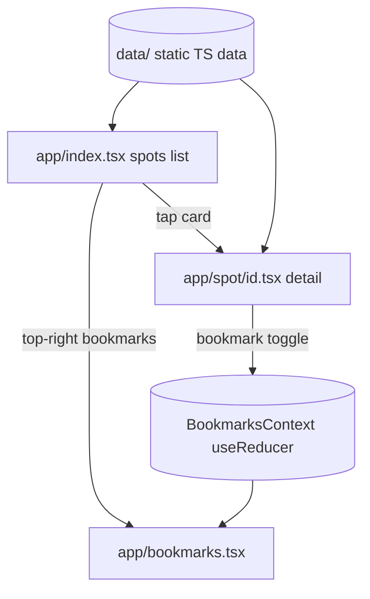

# Projects-app-mvp — Spots Collection (Mobile MVP)

A pure client-side **Expo + React Native** MVP: browse a few representative Shanghai attractions, view details, and bookmark favorites. Its main purpose is to validate a **Claude Code mobile agent preset** (`app-frontend-dev` implements, `app-reviewer` read-only reviews) on a real Expo project. Features are intentionally tiny: **no backend, data is static TypeScript modules**.

## Key Features
- **Spots list** (`app/index.tsx`): cards for 6 Shanghai spots (The Bund / Yu Garden / Oriental Pearl / Shanghai Museum / Tianzifang / Jing'an Temple); **search by CN/EN name + category filter** (combinable); empty state.
- **Spot detail** (`app/spot/[id].tsx`): hero image, intro, bookmark toggle; fallback when id not found.
- **My bookmarks** (`app/bookmarks.tsx`): list of bookmarked spots, guidance when empty.
> Bookmark state is in-memory only; cleared on restart (intentional MVP trade-off, not a bug).

## Tech Stack
| Item | Version / Note |
|------|----------------|
| Expo SDK | 57 |
| React Native | 0.86 |
| React | 19.2 |
| Routing | expo-router (file routing under `app/`, Stack) |
| Language | TypeScript (strict) |
| State | React Context + `useReducer` (`context/BookmarksContext.tsx`) |

## Architecture & Workflow


## Project Structure
```
Projects-app-mvp/
├─ app/            # expo-router pages (index / spot/[id] / bookmarks)
├─ context/        # BookmarksContext (state)
├─ data/           # static spot data
├─ assets/
├─ app.json / package.json / tsconfig.json
└─ README.md / README_EN.md
```

## Getting Started
```
npm install
npx expo start      # open with Expo Go or a simulator
```

## License
See `LICENSE`.